# Using Saraf

The UI is Persian and right-to-left, with a light and a dark theme (the sun icon, top left). The top bar has three
pages: **معامله** (trade), **بازار** (markets) and **استراتژی** (strategy). The pill next to the theme toggle shows
whether chat orders are paper (آزمایشی) or real (معاملات واقعی) and switches between them.

## Trade page

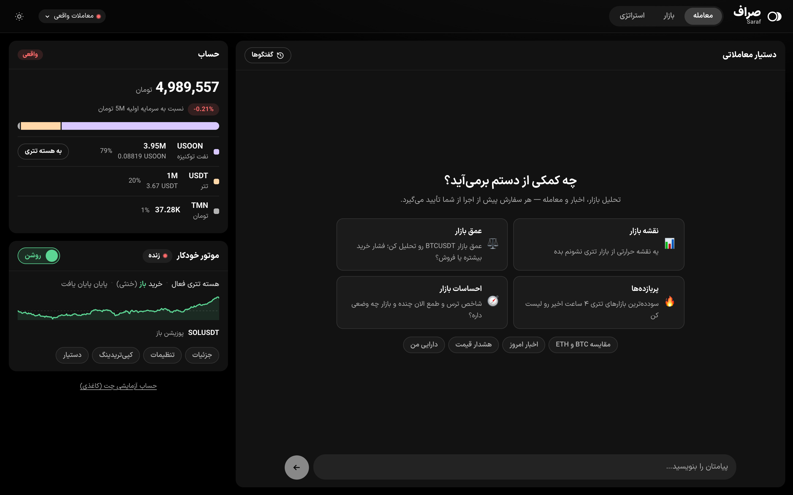

The assistant (دستیار معاملاتی) takes most of the page. The side column holds:

- **حساب (account)**: total value in Toman, the change against starting capital, and an allocation bar with each
  asset's share. A badge shows whether this is the real account (واقعی) or the paper one.
- **موتور خودکار (autonomous engine)**: on/off switch, live or simulated mode, the equity curve, open positions,
  and shortcuts into the strategy page.
- A link to the paper account the chat trades with.

### Chatting

Ask in Persian or English. The suggestion cards and chips under the greeting start common requests: market map,
order book depth, sentiment, top movers, comparisons, news, alerts, your holdings.

Each step the assistant takes appears as a chip (✓ when it finished), and the reasoning can be expanded from
**فکر کردن…**. Past conversations are under **گفتگوها**, and **گفتگوی جدید** starts a fresh one.

### Charts and widgets in the conversation

The assistant can draw instead of describing. The full list is in [the agent docs](agent.md#generative-ui).

| | |
|---|---|
| 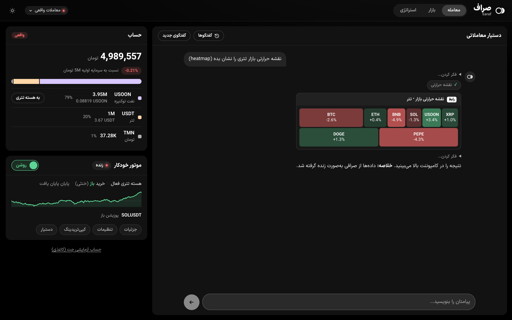 | 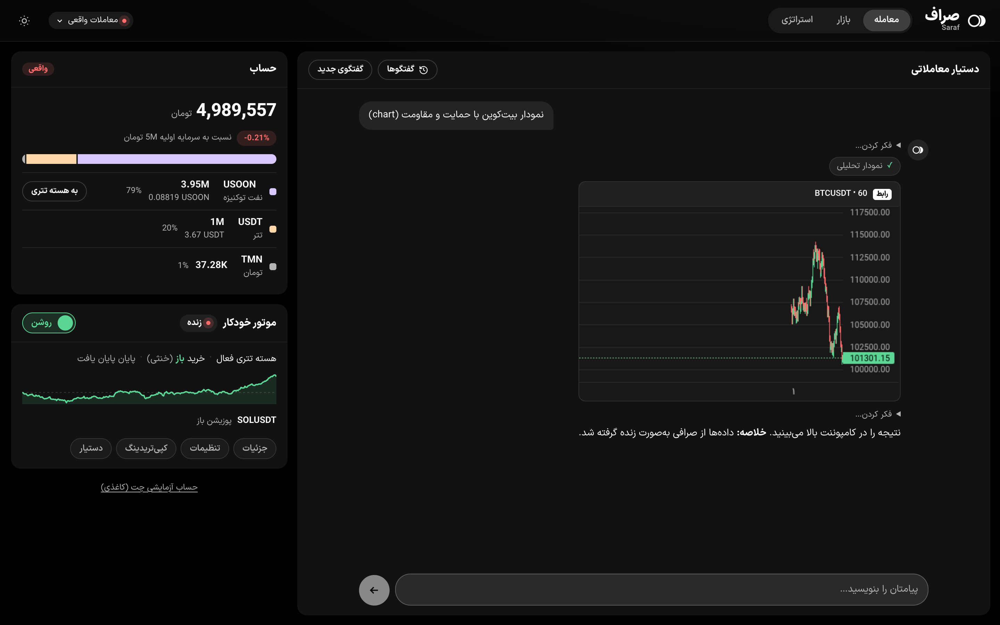 |
| Market heatmap: tile size is volume, colour is 24h change. Click a tile to ask about that market. | Candles with the levels the assistant is talking about. |
| 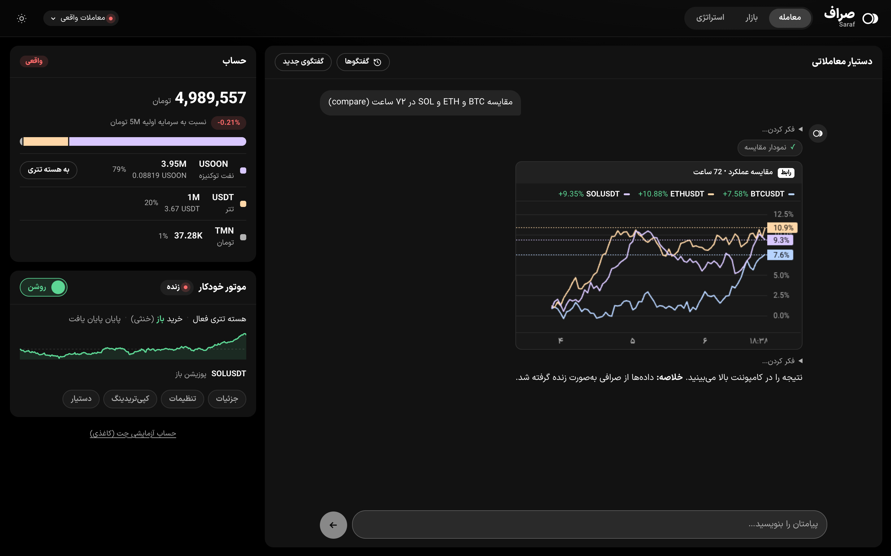 | 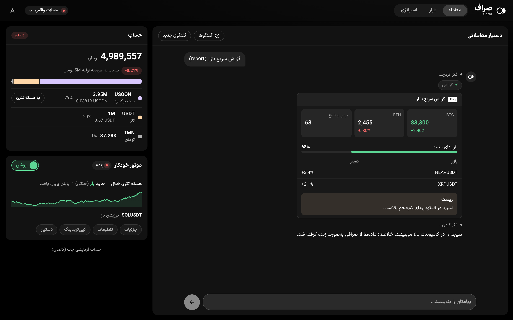 |
| Performance of several markets on one chart. | A free-form report of metrics, tables, progress bars and callouts. |

### Placing orders

Nothing is executed straight from a chat message. A trade request first passes the
[risk guard](agent.md#risk-guard), then shows up as a confirmation card with the reference price, notional, margin
and any warnings (here: no stop-loss set). The order runs only when you press **تأیید و اجرا**. **رد** discards it.

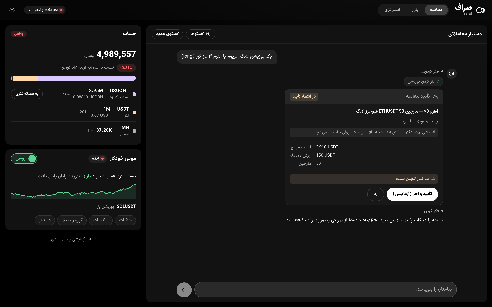

Two widgets let you shape the order yourself before it reaches that card:

| | |
|---|---|
| 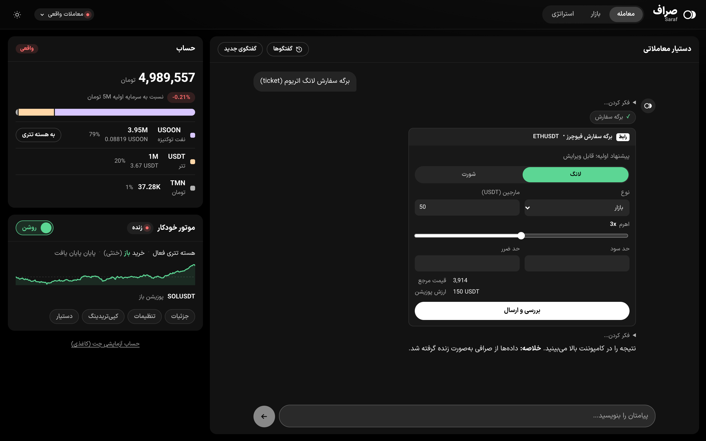 | 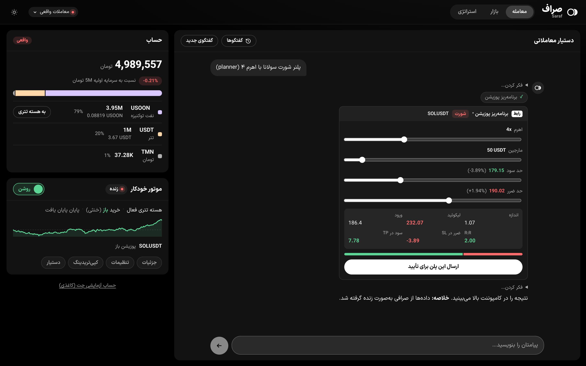 |
| Trade ticket: a pre-filled, editable order form. | Position planner: leverage, margin, TP and SL sliders with live liquidation price, PnL and risk/reward. |

### Price alerts

Ask for an alert ("alert me if BTC drops below 80k") and the assistant creates it. A background checker watches the
price, and a notification appears in the app when it fires.

## Markets page

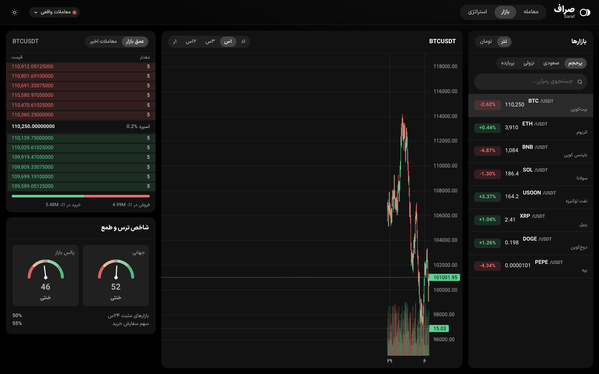

- **بازارها (markets)**: Toman or USDT markets, sorted by volume, gainers, losers or most profitable, with search.
- **Chart**: candles and volume for the selected market, from 1 minute to 1 day.
- **عمق بازار / معاملات اخیر**: the live order book with the spread and buy/sell pressure within 1% of the mid,
  or the latest public trades.
- **شاخص ترس و طمع**: the global crypto Fear & Greed index next to Market Pulse, a 0-100 index computed from
  the venue's own top 50 markets (see [Market Pulse](agent.md#market-pulse)).

## Strategy page

The control room for the [autonomous engine](engine.md). The header shows live or simulated mode, the return so far,
the time left in the session, and the same on/off switch as the trade page.

| tab | |
|---|---|
| **نمای کلی** (overview) | return against starting capital and against simply holding, drawdown, trade count, the equity curve, capital mix, the market-breadth gate, open positions, recent trades and every engine decision with its reason |
| **تنظیمات** (settings) | which account the engine trades (simulated or real), schedule, sizing and risk, entry setups and thresholds. Saving restarts the engine with the new settings and keeps its positions |
| **کپی‌تریدینگ** (copy-trading) | real on-chain traders to follow, and strategy personas with their own simulated track records |
| **دستیار** (assistant) | a chat about the engine ("why isn't it trading?", "halve the risk per trade"). With **اعمال مستقیم** (apply directly) on, it changes the settings itself; otherwise it proposes them. Every change can be undone |
| **شواهد** (evidence) | every idea that was tested, its result and whether it was kept |

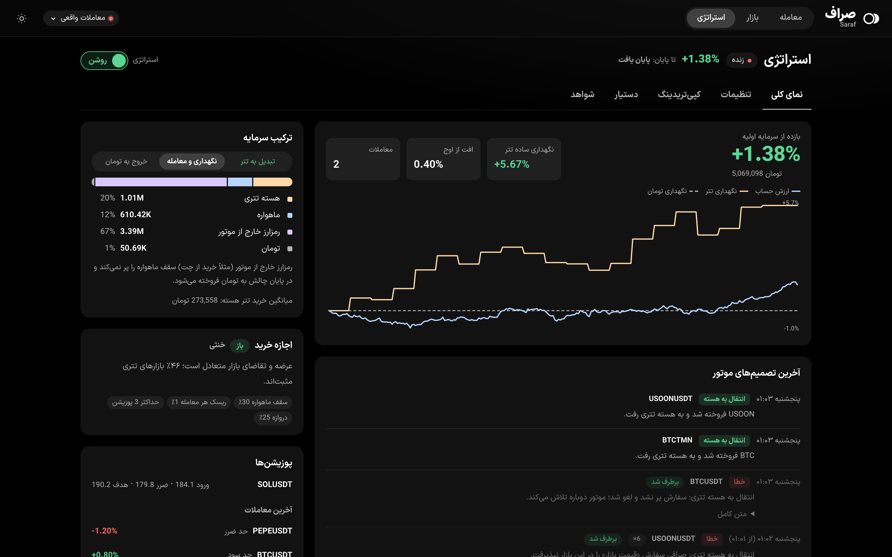

| | |
|---|---|
| 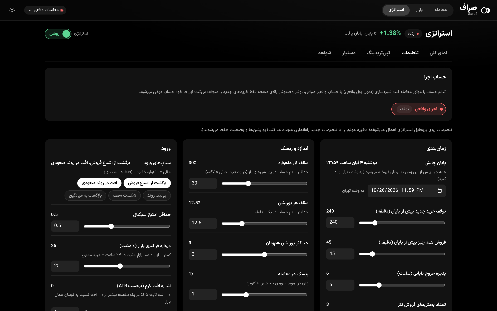 | 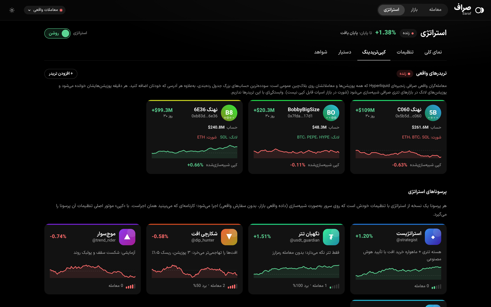 |
| 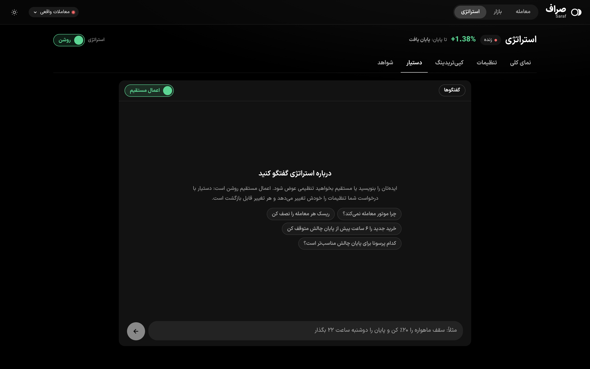 | 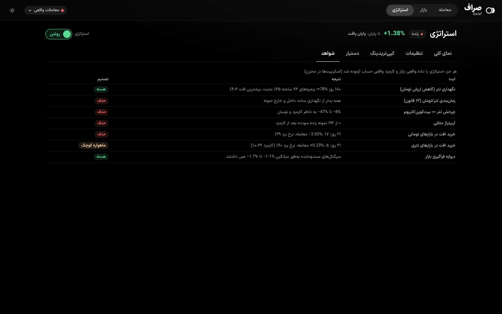 |

## Settings page

**تنظیمات** holds what used to need `.env` and a restart:

- **اتصال‌ها** (connections): a card per venue with what it supports, whether a key is set, and its key fields.
  **آزمایش اتصال** (test) reads the account behind the key, or the market list for a venue without one. **ذخیره**
  (save) applies at once. Saved keys never come back to the browser; a field shows only the last four characters
  and whether the value came from the app or from `.env`. **پیش‌فرض شود** makes a venue the default: orders, the
  dashboard and alerts move to it, each venue keeping its own paper balances. In live mode, changing the default venue
  or its keys asks for confirmation first.
- **مدل هوش مصنوعی** (AI model): the chat assistant's endpoint, key and model, with a test button. The engine keeps
  its own `ENGINE_LLM_*` settings.

When more than one venue has a key, the account card on the trade page gets a picker to view each venue's balances.

## Mobile

On narrow screens the columns become tabs at the bottom: market, agent, holdings, strategy, settings.

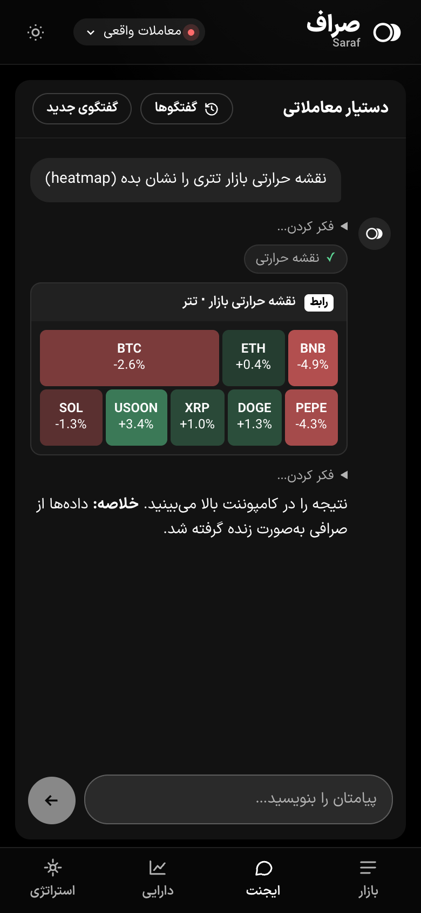
